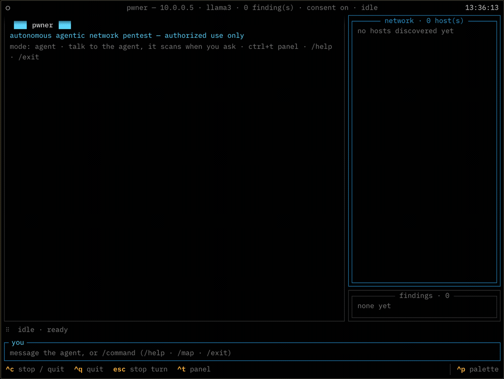

<h1 align="center">pwner</h1>

<p align="center">
  An agentic network pentest tool you talk to.
</p>

<p align="center">
  
</p>

<p align="center">
  <sub><b>Example session</b> against a fictional lab host. The agent's wording and the counts
  are illustrative, not a recording of a live run. Note the last four lines: it asks before
  anything intrusive, and a refusal stops it.</sub>
</p>

`pwner` is an LLM-driven agent that plans and runs a network penetration test from your
terminal. It discovers hosts, fingerprints services, checks them against known issues, and —
when the target warrants it and **you** approve — exploits them to prove impact. It drives
real tools (nmap, nuclei, netexec, impacket, hydra and others) rather than simulating them,
and it reports confirmed findings with severity, evidence and a fix.

It runs on your own model, or on no model at all.

- **You talk to it.** Not a flag soup: say *"scan it, focus on the database"* and it decides
  what to run, shows you its reasoning as it goes, and you can redirect it mid-run.
- **Scope is enforced in code.** Every tool call is checked against the target you named
  before it runs — not asked of the model in a prompt. See [Safety model](#safety-model).
- **Intrusive actions are denied by default.** Brute-force, remote command execution,
  credential dumping and reverse shells need your explicit approval.
- **Your model, your machine.** OpenAI, Anthropic, Google, DeepSeek, Ollama, or any
  OpenAI-compatible endpoint. Nothing is sent anywhere until you configure one.
- **Works with no model.** `--no-ai` runs the full discovery → fingerprint → detect pipeline
  deterministically, with no API key and nothing leaving the machine.
- **47 tools** across nmap, HTTP, per-service probes, Active Directory and credential work,
  each a thin wrapper over the standard binary rather than a reimplementation.

## Safety model

Two mechanisms, both in the tool layer, both outside the model's reach. The model can ask
for anything; it cannot widen its own authorization.

**Scope lock.** [`build_dispatch`](pwner/tools/core.py) wraps every tool so each
host-carrying argument is checked against your target *before* the tool body runs. Tools are
in-scope-by-default: one that forgets its own check is still guarded, and an unregistered
tool name fails closed. A network argument has to sit entirely inside the authorization, so
a `/24` scope cannot be widened to a `/16` by a tool argument.

**Consent gate.** Anything active is denied unless you approve it in that session. The agent
cannot self-approve — consent is resolved outside the model, and in a non-interactive run
the answer is always no.

These two are the part of the codebase under the most test: 77 tests on the scope boundary
in [`tests/test_scope.py`](tests/test_scope.py) and 13 on the consent gate in
[`tests/test_consent.py`](tests/test_consent.py), out of 410 overall. If you are going to
read one thing before pointing this at a network, read those.

Intended use:

- Authorized penetration tests, with written permission and an agreed scope
- Bug-bounty work, inside the program's stated rules
- Your own lab, your own hardware, CTFs
- Security research on systems you own

Not this tool's purpose, and not defensible:

- Anything on a host you do not own and have no written permission to test
- "Just checking" a network you happen to be on
- Anything where you cannot name who authorized it

## Install

Python **3.10+**. **nmap is the only hard requirement** — everything else enables more tools
and is optional.

```bash
brew install 0x45dd/tap/pwner
```

That brings nmap with it. From source instead:

```bash
git clone https://github.com/0x45dd/pwner.git
cd pwner
python3 -m venv .venv && source .venv/bin/activate
pip install -e .
```

Then the external tools, and a check:

```bash
./scripts/install-deps.sh   # brew/apt/pacman/dnf
pwner doctor               # what's missing
```

`install-deps.sh` installs only what is missing and skips anything your distro does not
package instead of failing. `pwner doctor` reports every external tool, what each one
enables, and the install command *for the system you are on*; it exits non-zero only when
nmap is missing, so it works as a setup check in a script.

<details>
<summary><b>uv, or just the command</b></summary>

```bash
uv venv && uv pip install -e .
pipx install -e .
```

</details>

<details>
<summary><b>Docker</b></summary>

The whole toolchain in one image, nothing installed on your host:

```bash
docker build -t pwner .
docker run --rm -it --net=host \
  --cap-add=NET_RAW --cap-add=NET_ADMIN \
  -v pwner-config:/root/.config/pwner \
  -v pwner-sessions:/root/.local/share/pwner \
  pwner
```

`--net=host` and the two capabilities are what let nmap do SYN scans and ICMP/ARP discovery;
without them it quietly falls back to slower connect scans and finds fewer hosts. The
volumes persist your key and your saved transcripts.

This Dockerfile has **not been built end to end yet** — the package names and release assets
in it were checked against the Debian archive and the upstream APIs, but treat the first
build as untested.

</details>

## First run

```bash
pwner
```

The first run asks for a provider and an API key once and saves them to
`~/.config/pwner/config.json` (owner-only). Every run after that drops you straight into a
session. Change it later with `pwner setup`.

```bash
pwner chat 10.0.0.5          # session, target set
pwner 10.0.0.0/24 --no-ai    # sweep, no model
pwner doctor                 # tool status
```

In a session you talk to the agent and steer it while it works; `/help` lists the commands,
`/findings` and `/topology` show what it has built so far, and `/dump` writes the transcript
to `~/.local/share/pwner/sessions/` (owner-only — it contains every credential the
engagement turned up, in cleartext).

## Your model

Point it at a provider and give it a key. Presets cover OpenAI, Anthropic, Google, DeepSeek
and Ollama; anything else that speaks the OpenAI API works via `--base-url`.

```bash
export PWNER_API_KEY=...
pwner chat 10.0.0.5 --provider anthropic
```

The model has to support tool calling. `pwner chat --help` lists the presets and every
override; each preset's default model is in [`pwner/llm.py`](pwner/llm.py). Model names move
too fast to be worth pinning in a README.

## Running without a model

`--no-ai` runs the deterministic suite: host discovery, port scan, service detection, OS
fingerprint and known-issue detection, then the same findings report. No API key, no network
calls beyond the scan itself, and reproducible — which makes it the mode to use in CI, on an
air-gapped engagement, or when the data cannot leave the building.

The active tools are the agent's; they need both a model and your consent.

## Documentation

Full command and config reference, the agent loop, the module catalogue and the rules live at
**[pwner.si](https://www.pwner.si/)**:

- [Docs](https://www.pwner.si/docs) — install, first session, every command and flag
- [Agent](https://www.pwner.si/agent) — how the loop works and what it can and cannot do
- [Modules](https://www.pwner.si/modules) — all 47 tools and what each one drives
- [Rules](https://www.pwner.si/rules) — scope, consent, responsible use
- [Contributing](CONTRIBUTING.md) — development setup, the tools package, adding a tool
- [Security](SECURITY.md) — reporting a vulnerability in pwner itself

## License

[GNU AGPL-3.0-or-later](LICENSE). Copyright (C) 2026 Berk D.

Strong copyleft, with a network clause: if you modify pwner and let other people use it over
a network, you owe them the modified source too.

> [!WARNING]
> **Authorized use only.** pwner sends real traffic to the hosts you name and, with your
> approval, actively breaks into them. Only run it against systems you own or have explicit,
> written permission to test, and stay inside the agreed scope. Unauthorized testing is
> illegal in most jurisdictions.
> Obtaining that authorization is your responsibility, not the tool's. pwner is provided
> as is, with no warranty and no liability for misuse. The scope lock and the consent gate
> are engineering, not a legal defence.
